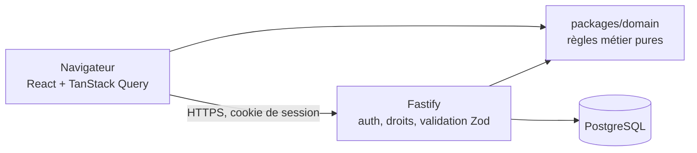

# Architecture

Un seul service : le serveur Fastify expose l'API sous `/api` et sert l'interface construite. Tout passe par la même origine, ce qui permet un cookie de session `SameSite=Strict` sans configuration CORS.

## Découpage

- **`packages/domain`** ne dépend ni du réseau ni de la base. Il contient les calculs (tarifs, courses, mémoires, jours fériés, montants en lettres) et les schémas Zod partagés. L'interface s'en sert pour les aperçus, le serveur pour décider.
- **`apps/api/src/routes`** : une route par ressource. Chaque route commence par `requireUser` ou `requireAdmin`, puis valide son entrée avec Zod.
- **`apps/api/src/mappers.ts`** : conversion entre la base et le domaine, et **retrait des montants** pour les chauffeurs (`redactEvent`, `toCircuitSummary`).
- **`apps/web/src`** : un dossier par écran. Les données viennent de TanStack Query, avec rafraîchissement automatique toutes les 30 secondes pour que le gérant voie les signalements des chauffeurs.

## Modèle de données

| Table       | Contenu                                                                   |
| ----------- | ------------------------------------------------------------------------- |
| `users`     | Gérant et chauffeurs. Un chauffeur correspond à un agenda.                |
| `sessions`  | Empreinte du jeton, dernière activité.                                    |
| `settings`  | Ligne unique : société, TVA, établissements facturés.                     |
| `clients`   | Fichier clients.                                                          |
| `circuits`  | Colonnes principales, plus `config` en JSONB (planning, tarifs, trajets). |
| `events`    | Rendez-vous et courses ; `run` en JSONB porte jeunes et montants.         |
| `audit_log` | Qui a écrit quoi et quand, sans le contenu.                               |

Le paramétrage d'un circuit est lu et écrit d'un bloc et validé par `circuitConfigSchema` : le JSONB évite une dizaine de tables de jointure sans perdre la validation. Les colonnes interrogées (`date`, `driver_id`, `circuit_id`, `series_id`, `status`) restent de vraies colonnes indexées.

**Attention :** PostgreSQL ne conserve pas l'ordre des clés d'un JSONB. Ne jamais dépendre de `Object.keys` pour un ordre métier ; utiliser par exemple `circuitPeriods`.

## Règles à conserver

- **Fuseau :** les dates métier sont des chaînes `YYYY-MM-DD` à l'heure de Paris (`TZ=Europe/Paris` en production).
- **Horaires :** en minutes depuis minuit.
- **Montants :** toujours TTC en stockage, HT et TVA calculés à l'affichage.
- **Modifier un circuit** répercute horaires et tarifs sur ses courses à venir (`propagateCircuitChange`), sans toucher celles déplacées à la main. Les changements de trajets et de chauffeur ne valent que pour les courses créées ensuite.
- **Créer les courses** ne produit jamais de doublon : relancer sur une période ajoute seulement ce qui manque, y compris une course supprimée à la main.

## Migrations

Modifier `apps/api/src/db/schema.ts`, puis lancer `npm run db:generate` et versionner le SQL produit. Les migrations s'appliquent au démarrage du serveur.

## Limite connue

Deux personnes qui modifient la même course en même temps : la dernière écriture l'emporte. Ce risque est faible avec un seul gérant, car un chauffeur ne touche qu'aux présences et au statut de ses propres courses.
